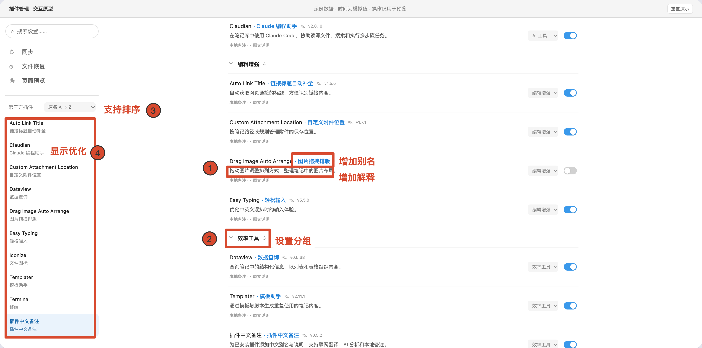

# Extension Index

插件索引

This plugin helps you view and organize your installed third‑party Obsidian plugins. It keeps the original plugin names while displaying their Chinese aliases and descriptions.

用于查阅与整理你已安装的 Obsidian 第三方插件，保留插件原名，同步展示中文别名与功能说明；支持设置分组和排序规则，内置 10,314 条插件中文参考资料，也支持自定义备注和 AI 批量分析。


*上图为功能宣传示意图，实际界面见下方截图。*

## 三步上手 / See it in action

1. 打开「设置 → 第三方插件 → 已安装插件」，直接查看原名旁的中文别名和下方的用途说明。左侧插件入口也会分行显示原名与别名。
2. 在已安装列表搜索原名或中文别名；按需要调整左右两处的排序，或开启「分组显示」并将插件归入自己的分组。
3. 点击插件名称旁的小铅笔，写下自己的别名和备注。个人修改优先显示，也可以在编辑窗口恢复预置内容。
4. 在本插件的设置详情中，可以使用免费的翻译功能和配置自己的AI模型，对未翻译的软件补充。

例如，截图中的 `Dataview` 显示为「笔记数据查询」，并被放入「日常工具」分组；这只是测试库里的示例归类，不会预设你的分组。

## 主要功能

- 在侧边栏分行展示插件原名及中文别名；已安装插件列表支持按原名或中文别名搜索，可自定义排序与分组。
- 支持为插件设置自定义别名、备注和分组，也能随时恢复预置内容；个人编辑内容优先级高于自动生成内容与内置资料库。
- 内置 10,314 条离线中文参考资料，覆盖 2026-11-13 官方目录快照中累计下载超过 10 次的全部 10,253 个插件，并保留 61 条原有范围外资料。资料可能存在翻译不准确或内容滞后的情况，欢迎通过反馈渠道指正。
- 可按需联网翻译缺失的插件介绍，或是调用你自行配置的 AI 服务解析插件公开文档。相关功能需手动启用，调用 AI 服务可能产生费用。



*实际界面示例。免费翻译补全缺少的中文名称与说明，不覆盖个人备注；AI 分析需要自行配置服务。*

离线资料和个人备注无需联网。本插件不会读取或发送你的笔记正文或个人备注；联网翻译会发送插件名称和描述，AI 分析可附带公开 README 摘录。仅支持 Obsidian 1.14.5 及以上桌面版，界面目前为中文。按时间排序使用插件文件夹的创建时间，它不一定等于安装时间。本插件不负责安装、更新或卸载其他插件。

## Requirements / 运行要求

- Obsidian **1.14.5 or later** on desktop. Mobile support has not been verified and is not declared.
- Chinese interface and Chinese generated output. Plugin-list integration uses native settings DOM and may require adaptation after future Obsidian updates.
- No runtime dependencies, telemetry, account requirement for offline use, or hosted backend operated by this project.

## Install / 安装

Community-store availability is shown on the [directory listing](https://community.obsidian.md/plugins/plugin-zh-notes). If the entry is still under review, use a published GitHub release for manual installation.

For manual installation, download `main.js`, `manifest.json`, and `styles.css` from the same published GitHub release. Put them in `<your vault configuration directory>/plugins/plugin-zh-notes/`, reload the plugin list, and enable it. When updating, preserve your existing `data.json`.

Do not treat a draft release or this repository's default branch as a published installable version. Release tags use the exact manifest version, without a `v` prefix.

## Use / 使用方法

1. Open **Settings → Community plugins → Installed plugins**. 中文别名和说明直接显示在已安装列表中；左侧插件设置入口显示原名和中文别名。
2. 左右两处可分别选择排序。已安装插件列表支持按中文别名搜索；打开「分组显示」，通过「管理分组」新建分组，并在插件行选择归属。
3. Click the small pencil next to a plugin name to edit your alias and description. Restore defaults through the same editor when needed.
4. Open **Settings → Extension Index → 免费翻译** to fill missing Chinese names and descriptions. Existing Chinese descriptions are reused to save quota. Names use machine translation, so brands and abbreviations may remain untranslated. Existing personal notes are preserved.
5. Open **AI 服务配置**, select a provider and model, enter your API key, and click **保存并测试**. This only saves and tests the connection. Then use step 3, **AI 翻译名称与使用说明**, for plugin descriptions. Interface translation remains available from each plugin’s sidebar icon; **免费翻译服务** explains the free fallback.

AI provider presets include DeepSeek, Qwen (Beijing), GLM, SiliconFlow, Kimi (China), OpenAI, local Ollama, and a custom compatible endpoint. The base URL is under advanced options. Model names and account permissions can change; a custom model ID can be entered.

停止按钮会阻止后续请求并丢弃迟到结果；已经发出的请求仍可能在服务商端完成和计费。已有生成缓存优先于新版内置资料；需要查看新版预置时，通过编辑窗口恢复预置。

## Network use, costs and privacy / 联网、费用与隐私

Offline references and personal editing work without network requests. Network actions occur only when you explicitly request translation, AI analysis, or an AI connection test.

| Service | Purpose | Data sent |
|---|---|---|
| `api.mymemory.translated.net` | Optional anonymous English-to-Chinese translation | Plugin name and public/local manifest description; no API key |
| `raw.githubusercontent.com` | Read the official community plugin catalog | A request for the public catalog; not an uploaded inventory of installed plugins |
| `api.github.com` | Fetch a plugin author's public README for AI analysis | The public repository path of the target plugin |
| Your selected AI endpoint | Optional analysis or connection test | Plugin ID, name, version, description and at most 6,000 characters of README excerpt; a connection test sends a short synthetic prompt |

Cloud AI presets connect to `api.deepseek.com`, `dashscope.aliyuncs.com`, `open.bigmodel.cn`, `api.siliconflow.cn`, `api.moonshot.cn`, or `api.openai.com`. Ollama uses your local `localhost` service. A custom endpoint sends the same analysis payload to the host you configure. Remote API connections require HTTPS; HTTP is allowed only for local endpoints.

**The plugin does not read or send your note contents or personal plugin annotations for translation or AI analysis.** It reads installed plugin manifests from the vault's own configuration directory. It does not access files outside the vault. Normal IP address and HTTP metadata are visible to the remote services you contact.

**Costs:** the plugin itself is free. Optional AI services may require an account, API key, and payment; a connection test may incur a small API charge. For the official directory, the appropriate payment classification is **Optional payment**. Existing ChatGPT subscriptions do not necessarily include API credit.

MyMemory documents an anonymous allowance of 5,000 characters per day. The plugin applies a conservative local budget of 4,500 characters per vault per UTC day. The service may count shared IP traffic differently; this is not a guarantee of available quota. Failed requests and rate limits preserve existing data.

Personal notes, generated caches, provider settings, key references, and translation-budget records are stored in this plugin's `data.json`. API key values are stored using Obsidian SecretStorage, not plaintext fields in that JSON file. SecretStorage is managed by Obsidian and is not a per-plugin security sandbox or a cross-device synchronization guarantee. Re-enter AI keys on another computer when necessary.

Service policies: [MyMemory terms](https://mymemory.translated.net/doc/usagelimits.php), [GitHub privacy](https://docs.github.com/en/site-policy/privacy-policies/github-general-privacy-statement). Your chosen AI provider's data handling also applies. There is no project-operated telemetry or translation proxy.

## Compatibility and data / 兼容与数据

Personal notes → generated cache → bundled reference is the lookup priority. Upgrading preserves existing `data.json`; schema-1 notes are read compatibly and migrate only on a subsequent save. Back up `data.json` before downgrading or deleting the plugin folder. This project does not implement cross-vault synchronization.

The left settings navigation keeps each original plugin name on the first line and shows its Chinese alias below. The Installed plugins list has a separate search box that matches original names and Chinese aliases; Obsidian's native search may not match the added aliases. Compatibility with other plugins that rewrite the same settings list is not guaranteed. The runtime does not install or update itself or other plugins.

## Development / 开发

This is a plain CommonJS JavaScript plugin. `src/plugin.js` is the authoritative source. `npm run build` checks it and copies its exact bytes to the runtime asset `main.js`, including the embedded MIT notices. There is no transpilation, minification, or executable download. The compact array near the top is the bundled text reference dataset, not obfuscated program logic.

```bash
npm ci
npm run build
npm test
```

`build` can regenerate `main.js` from a clean checkout even when the output is absent. Tests use Node's built-in runner, including a clean-directory regeneration check. Node 22 or later is recommended; no npm runtime dependencies are required. CI verifies tests and that regenerated release assets match the committed bytes. Release automation creates **drafts only**.

Desktop validation uses a dedicated QA vault with disabled manifest-only fixture plugins. Automated checks do not substitute for the official preview scan or physical-device tests.

## License and attribution / 许可与署名

Original plugin implementation and local curation: **Copyright (c) 2026 Frank998-dpf**, licensed under [MIT](LICENSE).

The bundled Chinese reference dataset derives from [miaoziguan/obsidian-chinese-plugin-market](https://github.com/miaoziguan/obsidian-chinese-plugin-market), fixed commit `c14006e74c678cf63174ae4de72a2a8e9832e253`, under MIT, **Copyright (c) 2024 羽鳞君 (miaoziguan)**. Dataset fields were selected, cleaned, and partly rewritten against the official community catalog. No upstream plugin runtime code was copied. Full third-party notice: [THIRD_PARTY_NOTICES.md](THIRD_PARTY_NOTICES.md).

The complete upstream MIT notice is also embedded in `main.js`, so it is retained when Obsidian installs only the standard runtime assets.

## Support / 反馈

Report bugs or specific translation corrections in [GitHub Issues](https://github.com/Frank998-dpf/plugin-zh-notes/issues). Include the target plugin ID and a short description; remove API keys, personal paths, and private note content before attaching logs or screenshots.

## 插件设置页翻译

设置仅保留“AI 服务配置”“免费翻译服务”两个页签。AI 页分为三步：配置 AI 服务、保存并测试、点击翻译插件中文名称与使用说明。两个 AI 功能共享服务与密钥；“保存并测试”始终只验证连接，不会自动开始批量翻译。免费页提供名称与说明的缺失补全，并说明设置页翻译入口。两类服务分别统计任务与进度，按钮明确标注处理范围及插件数量。

设置页优先使用内置及已保存词典，无缺失时不弹窗、不联网。有新增词条且 AI 尚未配置并测试时，会提示“未配置 AI 翻译，将优先使用免费的翻译服务，但是免费翻译服务的质量和额度是受限制的。”用户可选择“否，取消”“配置 AI 设置”“是，使用免费翻译”。取消或关闭弹窗不发请求；配置按钮只跳转 AI 页，由用户保存、测试，再点击第三步翻译名称与说明，不自动恢复原任务。明确同意后才使用 MyMemory 免费服务。已配置但连接失败时提示检查服务地址与运行状态，不将普通本机接口一律称为 Ollama。侧栏翻译图标为 13px 淡灰线条、无底色，悬停或键盘聚焦时加深。

设置侧栏中，每个第三方插件旁的翻译图标可打开操作浮层。内置译文默认离线应用，可按插件选择“显示原文”或“显示中文”。范围是可识别的分组标题、设置项名称、按钮和标签页文字；说明、输入内容、下拉选项、笔记正文和插件源码不被改写。

首批为 Calendar、Dataview、Templater、Advanced Tables、Outliner，共 82 条。词典按插件 ID 精确匹配，不保证覆盖全部设置或未来版本的语义变化。原文未变时复用；改名、新控件和新设置可能需补翻或人工维护。

“补翻新增”仅收集当前已打开设置页中可识别的短英文标签，不扫描完整源码。已配置并测试的 AI 服务每组最多 20 条、两组并发、逐组保存；用户同意使用免费服务时，沿用现有免费额度保护，逐条请求和保存。失败后重试跳过已有结果。展开折叠项或进入子页后可再次补翻。未配置 AI 时，内置词典仍可使用。补翻标签可能包含目标插件动态插入的上下文，开始前应核对当前页面。密钥继续使用现有 SecretStorage 配置，不写入词典。取消会阻止后续写入，服务端已经接收的请求仍可能继续执行。

### 词库维护依据

核对日期：2026-11-10。以下链接固定到当次核对提交；仅依据公开设置标签独立编写译文，未复制这些插件或 Chinese UI Translator 的实现代码。

| 插件 ID | 词条数 | 核对源码 |
| --- | ---: | --- |
| calendar | 11 | [Calendar settings](https://github.com/liamcain/obsidian-calendar-plugin/blob/ef3f2696da11aa1d11a272179caea062d6144640/src/settings.ts) |
| dataview | 27 | [Dataview settings](https://github.com/blacksmithgu/obsidian-dataview/blob/5ad0994ff384cbb797de382e7edff2388141b73a/src/main.ts) |
| templater-obsidian | 28 | [Templater settings](https://github.com/SilentVoid13/Templater/blob/006dc61f64902dc9c72cad15c26b988576339719/src/settings/Settings.ts) |
| table-editor-obsidian | 4 | [Advanced Tables settings](https://github.com/tgrosinger/advanced-tables-obsidian/blob/1a222399690f1d014d4bc95bf9ccf162ee5d7c75/src/main.ts) |
| obsidian-outliner | 12 | [Outliner settings](https://github.com/vslinko/obsidian-outliner/blob/9ce277885c5a2db002b6d0b926ab4b1ec167791e/src/features/SettingsTab.ts) |

数据集中维护于 `src/plugin.js` 的 `UI_BUILTINS`，与插件名称/用途的 `BUILTINS` 分开。补翻结果优先于内置词典，关闭状态及补翻结果随现有插件配置保存，个人备注不受影响。新增词条应核对源码和实际设置页，构建及测试后在独立 Obsidian 库验收；不要仅因版本号变化判定译文仍然正确。

本次桌面验收：Obsidian 1.15.0，独立库 plugin-zh-notes-qa；Calendar 1.5.10、Dataview 0.5.68、Templater 2.26.0、Advanced Tables 0.23.2、Outliner 4.11.0。新版本额外标签仅做源码核对，尚未逐项实机验收。设置页翻译已补做真实 DeepSeek 回归，详见下文。

新版交互回归：78 项自动测试通过；真实 Obsidian 设置窗口验证两个页签、AI 三步流程、服务选择的取消/配置/免费三个分支、免费译文缓存复用。免费路径验证使用受控响应且恢复测试状态，未调用真实付费 API。图标保持 13px 淡灰无底色。

### 设置页翻译可靠性修复与回归

界面译文允许品牌名、缩写及格式名保留原文，不再以“必须含汉字”作为格式要求；空值、错误类型、异常 HTML/控制字符及占位符损坏仍会拒绝。已安装插件的名称和 ID 从候选中排除。有效字段逐批保存，无效字段单列，可在翻译浮层查看原因并补翻；英文保留结果也会缓存，避免重复请求。两组并发与取消保护保持不变。

已识别控件逐个处理其文字节点，保留 SVG 与事件，跳过输入值、说明、代码和嵌套控件。Copilot 的无语义设置标签仅在其自身设置根节点应用已核实的类名规则；没有扩大为任意普通 div 扫描。切页会关闭旧翻译浮层。

2026-11-10 验证：82 项自动测试通过，真实 DOM 检查 SVG、事件、原文恢复及输入值保护通过。使用现有 DeepSeek / deepseek-flash 对同一安装清单做 28 次真实请求：15 个有英文设置标签的页面，按插件分别计 385 条，其中 362 条译为中文、23 条保留原文。Remotely Save 首次出现 20 条编号字段缺失，其余 99 条保存；只重试这 20 条后失败归零。该结果覆盖当前页面及原生折叠项，未穷举所有自定义子页，不构成完整语义质量或未来版本兼容保证。
